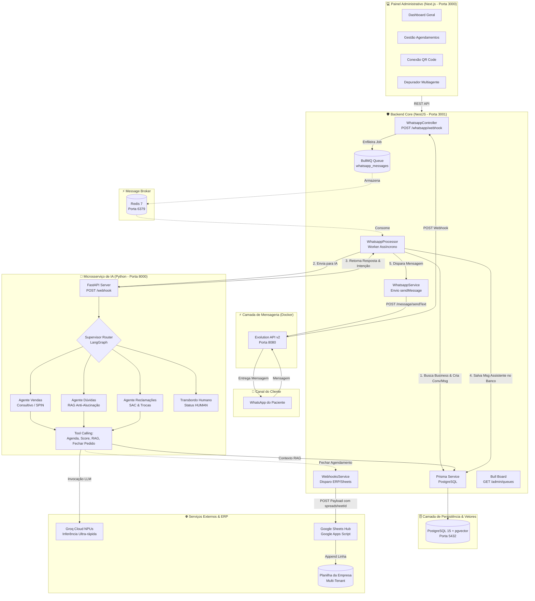
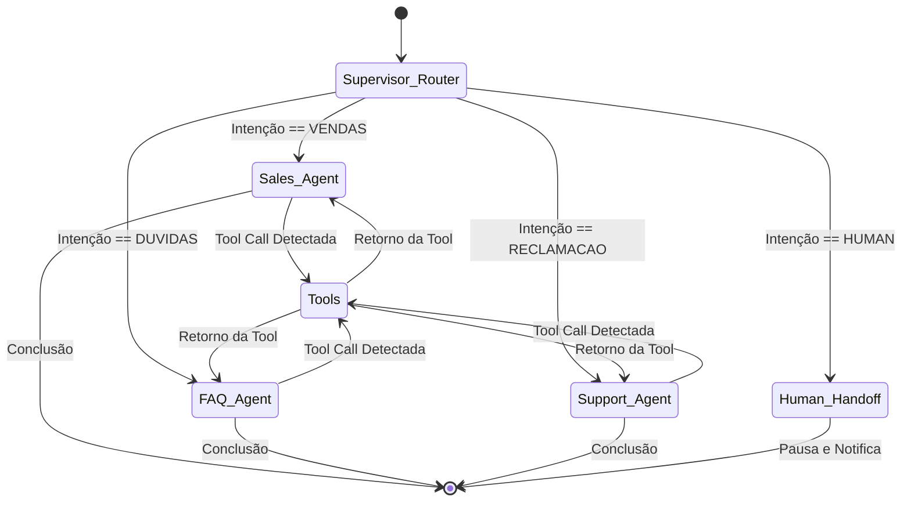
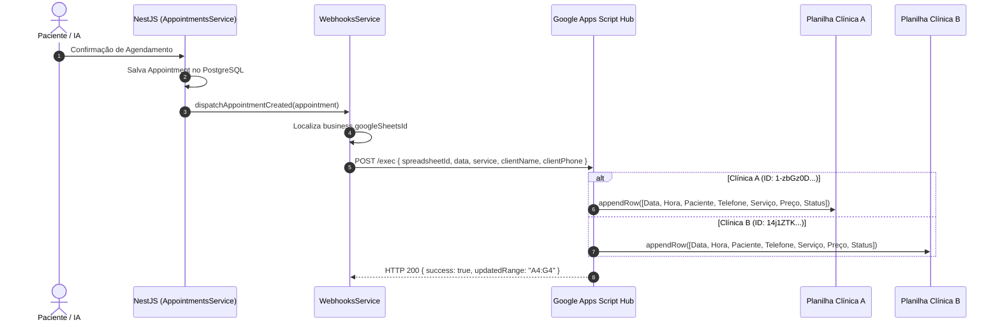
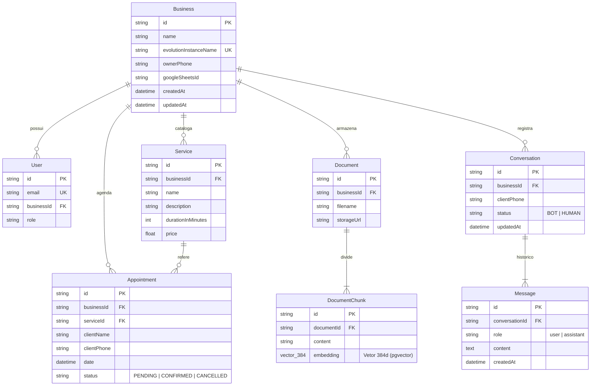

# Documentação Técnica da Arquitetura - Klinik OS

Bem-vindo à documentação técnica oficial e definitiva do **Klinik OS**, uma plataforma enterprise full-stack de atendimento autônomo, vendas consultivas e triagem inteligente para clínicas e empresas, impulsionada por **Inteligência Artificial Multiagente (LangGraph)**, **RAG Semântico (pgvector)**, **Filas Assíncronas (BullMQ)** e **Integrações ERP / Google Sheets**.

Este documento detalha a topologia do ecossistema, os microsserviços componentes, os fluxos de dados, a modelagem relacional/vetorial e as decisões de engenharia adotadas.

---

## 1. Visão Geral do Sistema

O Klinik OS é projetado para operar como o cérebro operacional e canal de atendimento automatizado via WhatsApp para empresas de saúde, estética e prestação de serviços.

### Pilares Fundamentais:
1. **Atendimento Multiagente Especializado**: Substitui o modelo de prompt monolítico por um grafo supervisor com roteamento inteligente entre agentes de **Vendas Consultivas**, **Dúvidas & Políticas (RAG)** e **SAC / Reclamações**, além de **Transbordo Humano prioritário**.
2. **Respostas Factuais sem Alucinações (RAG)**: Consulta documentos oficiais (tabelas de preços, normas, regras de devolução e políticas) vetorizados no PostgreSQL com extensão `pgvector`.
3. **Resiliência e Desacoplamento via Filas (BullMQ + Redis)**: As mensagens recebidas do WhatsApp nunca travam o servidor HTTP; são imediatamente enfileiradas para processamento assíncrono.
4. **Sincronização em Tempo Real com ERP / Planilhas**: Através de um Hub Centralizador Multi-Tenant (Google Apps Script / Webhooks), cada agendamento confirmado gera automaticamente uma linha formatada na planilha Google Sheets isolada daquela empresa.
5. **Observabilidade e Telemetria em Produção**: Métricas em tempo real expostas via Prometheus (`/metrics`) no NestJS e no FastAPI, com agregação de logs estruturados (Winston + Loki) e monitoramento de fila com Bull Board (`/admin/queues`).

---

## 2. Stack Tecnológica Global

```text
┌─────────────────────────────────────────────────────────────────────────┐
│                               KLINIK OS                                 │
├─────────────────────┬───────────────────────────┬───────────────────────┤
│ Frontend (Next.js)  │ Backend Core (NestJS)     │ AI Agent (Python)     │
│ React 19 / Turbopack│ TypeScript / Node.js      │ FastAPI / LangGraph   │
│ Tailwind CSS v4     │ Prisma ORM / pg Driver    │ LangChain / ChatGroq  │
│ Supabase Client     │ BullMQ & Bull Board       │ Prometheus & Loki     │
├─────────────────────┼───────────────────────────┼───────────────────────┤
│ Mensageria WhatsApp │ Dados & Vetores           │ Integrações Externas  │
│ Evolution API v2    │ PostgreSQL 15 + pgvector  │ Google Sheets Hub GAS │
│ Baileys Engine      │ Redis 7 (Broker Filas)    │ Groq NPUs (Llama/Qwen)│
└─────────────────────┴───────────────────────────┴───────────────────────┘
```

### Detalhamento por Camada:
- **Frontend**: Next.js 16 (App Router), React 19, TypeScript, Tailwind CSS v4, Lucide Icons.
- **Backend Core**: NestJS 11, Prisma ORM 5 com adapter `@prisma/adapter-pg`, BullMQ, `@bull-board/nestjs`, Axios / HttpService.
- **Microserviço AI Agent**: Python 3.10+, FastAPI, LangGraph, LangChain Groq, Pydantic, Prometheus FastApi Instrumentator.
- **Banco de Dados**: PostgreSQL 15 com extensão `pgvector` nativa (384 dimensões).
- **Mensageria & Broker**: Redis 7 Alpine, Evolution API v2 (WhatsApp Baileys).
- **Planilhas / ERP**: Google Apps Script Hub Centralizador Multi-Tenant via Webhook HTTP.

---

## 3. Arquitetura em Camadas e Diagrama de Topologia

O sistema implementa uma arquitetura modular distribuída, onde a ingestão de eventos, o processamento de linguagem natural e a persistência de negócios são desacoplados.

### Diagrama Arquitetural Completo (Fluxo de Dados)



---

## 4. O Microsserviço de IA Multiagente (Python LangGraph)

O diretório `ai_agent/` abriga o motor cognitivo autônomo, estruturado com **LangGraph** (StateGraph), permitindo decisões condicionais e orquestração determinística de ferramentas.

### 4.1. Grafo de Decisão (LangGraph Workflow)



### 4.2. Os Especialistas e suas Personas:

1. **Supervisor Router (`router_llm`)**:
   - Analisa o texto bruto do cliente e classifica deterministamente em 4 categorias:
     - `VENDAS`: Demonstração de interesse em preços, contratação, agendamento de procedimento ou compra.
     - `DUVIDAS`: Perguntas sobre funcionamento, localização, corpo clínico, formas de pagamento ou políticas.
     - `RECLAMACAO`: Insatisfação, cancelamento de plano/contrato, pedidos de devolução ou suporte crítico.
     - `HUMAN`: Pedido explícito para falar com uma pessoa ("quero falar com atendente", "humano", "falar com atendente").
2. **Agente de Vendas Consultivas (`sales_agent`)**:
   - Persona orientada a técnicas modernas de vendas (SPIN Selling e BANT).
   - Investiga a necessidade do cliente, ancora o valor dos serviços, apresenta soluções e conduz ativamente ao agendamento/fechamento.
3. **Agente de Dúvidas & FAQ (`faq_agent`)**:
   - Conectado diretamente à ferramenta `consultar_base_conhecimento`.
   - Lê trechos oficiais de manuais e regulamentos via busca semântica, respondendo com precisão matemática sem alucinar.
4. **Agente de Suporte e SAC (`support_agent`)**:
   - Atendimento acolhedor e resolutivo para pós-venda, esclarecimento sobre prazos de garantia e procedimentos de devolução.
5. **Transbordo Humano (`human_handoff`)**:
   - Ativa o sinalizador `human_intervention_needed = True`, alterando o status da conversa para `HUMAN` no PostgreSQL e suspendendo respostas automáticas da IA para aquele contato.

### 4.3. Ferramentas Disponíveis (Tool Calling):
- `consultar_base_conhecimento(pergunta)`: Executa busca semântica no NestJS (`/chat/context`) para obter trechos de documentos vetorizados no `pgvector`.
- `consultar_disponibilidade_agenda(data)`: Avalia horários disponíveis para agendamento.
- `calcular_score_lead(nivel_interesse, servico_escolhido)`: Qualifica e pontua o cliente no CRM interno.
- `fechar_agendamento(nome_cliente, telefone, data, servico)`: Conclui a reserva, grava na tabela `Appointment` e despacha para a planilha Google Sheets vinculada.

---

## 5. Resiliência e Filas Assíncronas (BullMQ)

Para suportar grandes picos de conversas simultâneas no WhatsApp sem gerar timeouts na Evolution API ou sobrecarregar a CPU com chamadas de LLM, o sistema utiliza **BullMQ** sobre **Redis**.

### Funcionamento do Worker:
1. **Ingestão Leve (Webhook)**: O `WhatsappController` recebe o evento `MESSAGES_UPSERT` da Evolution API e apenas enfileira o job `process_message` na fila `whatsapp_messages` (tempo de resposta < 15ms).
2. **Worker Dedicado (`WhatsappProcessor`)**:
   - Desacoplado da camada HTTP.
   - Resolve o `Business` correspondente à instância WhatsApp.
   - Busca ou cria a `Conversation` associada ao cliente (`clientPhone`).
   - Grava a mensagem do usuário (`role: 'user'`) no banco de dados.
   - Valida o estado: se a conversa estiver com status `HUMAN`, o worker suspende o processamento e não chama a IA.
   - Dispara a mensagem para a API Python (`http://localhost:8000/webhook`).
   - Recebe a resposta e, se o agente sinalizou transbordo, atualiza `Conversation.status = 'HUMAN'`.
   - Grava a réplica na tabela `Message` (`role: 'assistant'`).
   - Dispara a mensagem de volta para o cliente via Evolution API (`sendMessage`).
3. **Bull Board**: Painel de telemetria operacional disponível na rota autenticada `/admin/queues`, permitindo visualizar filas ativas, tempos de espera, taxa de processamento e reprocessar jobs falhos com 1 clique.

---

## 6. Sincronização Multi-Tenant com Google Sheets / ERP

O sistema resolve o desafio de integrar múltiplos clientes sem a necessidade de criar credenciais OAuth2 individuais ou configurar servidores dedicados para cada clínica.



### Características do Hub Multi-Tenant:
- **Zero Configuração de Credenciais pelo Usuário**: O administrador da clínica apenas cola o link ou ID da sua planilha no painel do Klinik OS (`/dashboard`).
- **Detecção Inteligente de Link**: O frontend e o backend aceitam tanto o ID puro quanto a URL completa (`https://docs.google.com/spreadsheets/d/.../edit`), extraindo o hash via Regex.
- **Roteamento Dinâmico**: O payload enviado ao Hub contém a chave `spreadsheetId`, garantindo isolamento total dos dados de agendamento entre clínicas.
- **Gatilhos Duplos**: O despacho para a planilha ocorre tanto quando a IA executa a ferramenta `fechar_agendamento` quanto quando o gestor confirma um agendamento manualmente pelo Dashboard.

---

## 7. Modelagem do Banco de Dados (PostgreSQL + pgvector)

O banco de dados relacional utiliza o **Prisma ORM** com a extensão nativa `vector` para buscas por similaridade semântica.



### Detalhes Estruturais:
- **`DocumentChunk.embedding`**: Armazenado como tipo vetorial `vector(384)`. A busca é realizada via SQL Raw utilizando o operador de distância de cosseno (`<=>`):
  ```sql
  SELECT id, content, (embedding <=> $1::vector) AS distance
  FROM "DocumentChunk"
  WHERE "documentId" IN (SELECT id FROM "Document" WHERE "businessId" = $2)
  ORDER BY distance ASC
  LIMIT 3;
  ```
- **`Conversation` e `Message`**: Cada contato do WhatsApp tem suas mensagens gravadas com carimbo de tempo, permitindo auditoria, reconstituição de contexto e controle de transbordo (`status = 'HUMAN'`).

---

## 8. Frontend e Experiência do Usuário (Next.js)

O painel administrativo foi projetado com estética clínica premium, utilizando tipografia moderna e feedback visual em tempo real.

### Mapeamento das Páginas do Dashboard:

| Rota | Descrição | Recursos Principais |
|---|---|---|
| `/dashboard` | **Visão Geral & Integrações** | Card de configuração da Planilha Google Sheets (suporta ID e URL), alertas de WhatsApp administrativo e status do workspace. |
| `/dashboard/appointments` | **Agendamentos** | Listagem de agendamentos, aprovação/cancelamento com 1 clique e botão de atalho **"📊 Abrir no Google Sheets ↗"**. |
| `/dashboard/whatsapp` | **Conexão WhatsApp** | Watchdog em tempo real do túnel Evolution API, exibição e auto-refresh de QR Code a cada 12 segundos e botão "⚡ Gerar do Zero". |
| `/dashboard/chat-test` | **Depurador Multiagente** | Ambiente de simulação de conversa em tempo real, com badges visuais da intenção detectada (`[VENDAS]`, `[DUVIDAS]`, `[RECLAMACAO]`, `[HUMAN]`). |
| `/dashboard/documents/new` | **Base de Conhecimento** | Upload e processamento de arquivos PDF com extração automática de texto, chunking e vetorização no pgvector. |
| `/dashboard/services/new` | **Serviços Clínicos** | Cadastro e precificação dos procedimentos oferecidos pelo estabelecimento. |

---

## 9. Observabilidade e Métricas de Produção

O Klinik OS possui telemetria integrada para monitoramento de SLA, saúde de filas e latência de inteligência artificial:

1. **Prometheus Metrics**:
   - **Backend NestJS**: Métricas de requisições HTTP, tempos de resposta e contadores em `http://localhost:3001/metrics`.
   - **Microsserviço Python**: Instrumentação automática de latência de inferência dos nós do LangGraph em `http://localhost:8000/metrics`.
2. **Logs Estruturados (Winston + Loki)**:
   - Configuração pronta para envio de logs estruturados em JSON para o Grafana Loki, permitindo rastrear o ciclo de vida completo de uma mensagem pelo seu `trace_id` ou telefone do cliente.
3. **Bull Board**:
   - Interface visual para monitoramento do throughput de mensagens do WhatsApp e latência da fila em `http://localhost:3001/admin/queues`.

---

## 10. Guia de Execução Local (Ambiente de Desenvolvimento)

### 10.1. Pré-requisitos
- Node.js >= 20, NPM
- Python >= 3.10 com ambiente virtual (`venv`)
- Docker & Docker Compose

### 10.2. Subindo a Infraestrutura (Docker)
Na pasta raiz do projeto ou em `backend/`:
```bash
cd backend
docker compose up -d
```
Isso iniciará:
- **PostgreSQL 15** (Porta 5432) com extensão `pgvector` e bancos `klinik` e `evolution` criados.
- **Redis 7** (Porta 6379) para filas do BullMQ.
- **Evolution API v2** (Porta 8080) com engine Baileys pronta para conexão com WhatsApp.

### 10.3. Configurando o Banco de Dados
```bash
cd backend
npx prisma db push
```

### 10.4. Executando os Microsserviços
Em terminais separados:

**1. Microsserviço de IA (Python LangGraph):**
```bash
# Na raiz do projeto:
.\ai_agent\venv\Scripts\python -m uvicorn main:app --app-dir ai_agent --host 0.0.0.0 --port 8000 --reload
```

**2. Backend Core (NestJS):**
```bash
cd backend
npm run start:dev
```
*Acessível em `http://localhost:3001` (Bull Board em `/admin/queues`, Métricas em `/metrics`).*

**3. Frontend (Next.js):**
```bash
cd frontend
npm run dev
```
*Acessível em `http://localhost:3000`.*

---

## 11. Testes Automatizados e Qualidade de Código (TDD)

O backend possui suíte abrangente de testes unitários desenvolvida em Jest, cobrindo controllers, serviços e o processador assíncrono de mensagens.

### Executando os Testes:
```bash
cd backend
npm test
```

### Resultados da Suíte de Testes:
```text
Test Suites: 11 passed, 11 total
Tests:       51 passed, 51 total
Snapshots:   0 total
Time:        13.735 s
Ran all test suites.
```

**Principais Cenários Testados:**
- **`WhatsappProcessor`**: Persistência de mensagens no banco, criação de `Conversation`, chamada ao agente Python com `tenant_id` real, despacho de mensagens de retorno e bloqueio de bot em modo `HUMAN`.
- **`BusinessService`**: Gestão de multi-tenancy e atualização do `googleSheetsId`.
- **`WebhooksService`**: Disparo HTTP formatado para o Google Apps Script Hub com dados de agendamento.
- **`AppointmentsService` & `AppointmentsController`**: Ciclo de vida completo do agendamento e sincronização com ERP.
- **`ChatService`**: Vetorização, RAG e extração de contexto estruturado.
- **`WhatsappService`**: Gerenciamento de instâncias na Evolution API (conexão, desconexão, status).

---

## 12. Glossário de Engenharia

- **LangGraph**: Framework de orquestração de LLMs baseado em grafos de estados cíclicos, possibilitando fluxos multiagentes e intervenção humana controlada.
- **BullMQ**: Biblioteca de mensageria baseada em Redis para o ecossistema Node.js, garantindo execução assíncrona, tolerância a falhas e controle de concorrência.
- **pgvector**: Extensão C para PostgreSQL que implementa armazenamento nativo de vetores multidimensionais e busca de vizinhos mais próximos (KNN) por cosseno ou distância euclidiana.
- **Multi-Tenancy**: Padrão de arquitetura onde uma única instância do sistema atende múltiplos clientes isolados, garantindo que regras de negócio, dados e planilhas de uma empresa nunca vazem para outra.
- **SPIN Selling**: Metodologia comercial que investiga Situação, Problema, Implicação e Necessidade de Solução, adotada no prompt do `sales_agent`.
- **Human Handoff (Transbordo)**: Mecanismo onde o agente autônomo detecta que o cliente precisa de atenção humana ou expressa insatisfação crítica, pausando a IA e alertando a equipe de atendimento.

---
*Documentação técnica oficial do Klinik OS — Atualizada para a arquitetura Multiagente & Enterprise.*
